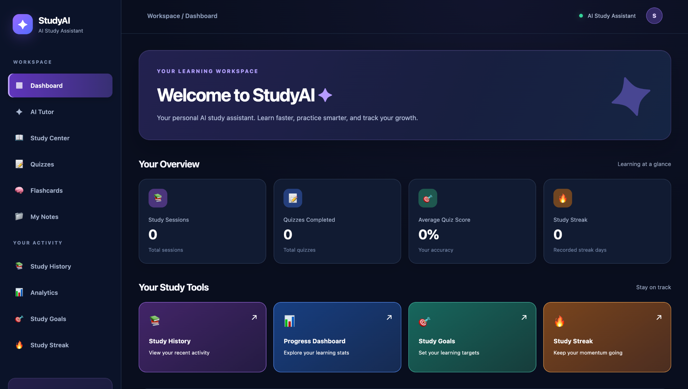

# StudyAI — AI Study Assistant

StudyAI is a website I built to help students study and learn more easily. It uses AI to explain topics, make quizzes, create flashcards, and help students keep track of their progress.

I wanted to build something that students could actually use, not just a simple school project.

## Try StudyAI

**[Open StudyAI](https://study-ai-tkyb.onrender.com)**

The website may take a little time to load if it has not been used in a while.

## What StudyAI Looks Like



## What You Can Do

### AI Tutor

Ask questions about anything you're studying and get explanations that are easy to understand.

### Study Center

Enter a topic and get a lesson to help you learn it.

### Quizzes

Take quizzes to test what you know. You can check your answers and see how well you did.

### Flashcards

Use flashcards to remember important information and review what you've learned.

### My Notes

Upload your notes and use AI to help you study them.

### Study History

Look back at what you've studied and keep track of your past work.

### Analytics

See your quiz scores, study activity, and learning progress.

### Study Goals

Set study goals and make plans for upcoming exams.

### Study Streak

Keep track of how often you study and build better study habits.

## What I Used to Build It

- **HTML** — To build the website.
- **CSS** — To design how everything looks.
- **JavaScript** — To make the website interactive.
- **Node.js and Express** — To run the backend.
- **OpenAI API** — To power the AI features.
- **GitHub** — To store and share my code.
- **Render** — To put the website online.

## How to Use StudyAI

1. Open the website.
2. Pick a study tool from the menu.
3. Enter a topic or upload your notes.
4. Start learning with lessons, quizzes, or flashcards.
5. Check your progress and set study goals.

## How to Run It on Your Computer

First, download the project from GitHub.

Open the project folder in your terminal and install everything it needs:

```bash
npm install
```

Create a file called `.env` and add your OpenAI API key:

```env
OPENAI_API_KEY=your_api_key_here
```

Keep your real API key private. Never upload it to GitHub.

Then start the website:

```bash
npm start
```

Open `http://localhost:3000` in your browser.

## Why I Built StudyAI

I built StudyAI because I wanted to create something useful for students.

Studying can be hard, especially when you don't understand a topic or don't know where to start. I wanted to make a website where students could find different study tools in one place.

While building StudyAI, I learned more about coding, working with AI, fixing problems, designing websites, and putting a project online.

I also wanted to challenge myself by building a full website instead of just a small program.

## What's Next?

I plan to keep improving StudyAI by adding more features, making the website easier to use, and finding new ways to help students learn.

---

**StudyAI — A better way to study, learn, and grow.**
