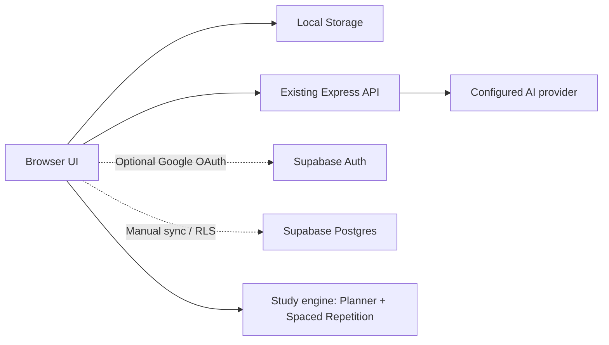

# StudyAI — Pro Portfolio Upgrade

A progressive upgrade to your **existing** working StudyAI project. Preserves your AI backend, existing lesson/quiz/flashcard logic and all ten navigation screens. Restores colorful learning mode buttons and study-tool cards.

## Install

1. **Back up your original project folder.**
2. Unzip and drag `index.html`, `style.css`, `script.js`, `navigation.js`, `study-engine.js`, `portfolio.js`, `cloud.js`, and the folders into your project root (alongside your existing `server.js`).
3. Keep your existing `server.js`, `package.json`, `.env`, and `node_modules`. Do not delete them.
4. Refresh `http://localhost:3000` using Command + Shift + R.
5. Test lessons, PDFs, quizzes, and flashcards before using the new features.

## Included and functional locally

- Colorful purple/blue/teal learning mode buttons and purple/blue/green/orange study tools.
- All ten existing sidebar screens, notes, and current AI workflows.
- Study planner: exam date, rotating topics, daily checklist, progress bar, iCalendar export. The schedule is algorithmic, **not** generated by AI.
- Spaced-repetition deck: add cards, reveal, rate Again/Hard/Good/Easy, persistent due dates. Uses an **SM-2-inspired** algorithm, not FSRS.
- 25-minute focus timer with break mode and completed minutes.
- Learning insights, CSV quiz export, Markdown notes export.
- Tests for the learning engine and GitHub Actions syntax/test workflow.
- Dockerfile and Compose example for deploying the existing Node backend.
- Optional Google login and Supabase cloud sync after configuration (manual sync).

## Optional cloud setup (not active out of the box)

1. Create a Supabase project. Enable Google provider under Authentication > Providers and configure Google OAuth credentials and redirect URLs.
2. Run `supabase-schema.sql` in the Supabase SQL editor. It enables row-level security (RLS) for per-user data.
3. Copy `cloud-config.example.js` to `cloud-config.js` and enter your project URL and **publishable/anon** key. NEVER enter your service-role key in browser files.
4. In Supabase Auth URL configuration, allow your actual localhost and deployed callback origins.
5. Reload the app, sign in with Google, and press **Sync now**.

**Cloud sync limitations:** manual and last-write-wins, not real-time collaboration. Browser localStorage is not suitable for sensitive student records. Cloud sync only covers the listed localStorage keys and does not migrate all possible existing app state. Do not use real private student data without a security/privacy review.

## Testing

Run `node --test tests/*.test.js`. GitHub Actions runs syntax checks and unit tests. There is no automated RAG evaluation, browser E2E testing, production observability, or validated security audit in this bundle.

## Architecture

## Next serious milestones

Implement page-accurate PDF citations and hybrid retrieval with retrieval quality benchmarks; server-enforced authentication for AI endpoints; real-time collaborative rooms with access controls; robust E2E tests; performance/latency dashboards; a deployed demo and real user feedback. The many external services in your wishlist (Neo4j, LangGraph, Qdrant, Ragas, Whisper, E2B, etc.) are **not** claimed to be integrated. Adding them all without verification would make this project less reliable, not more impressive.
